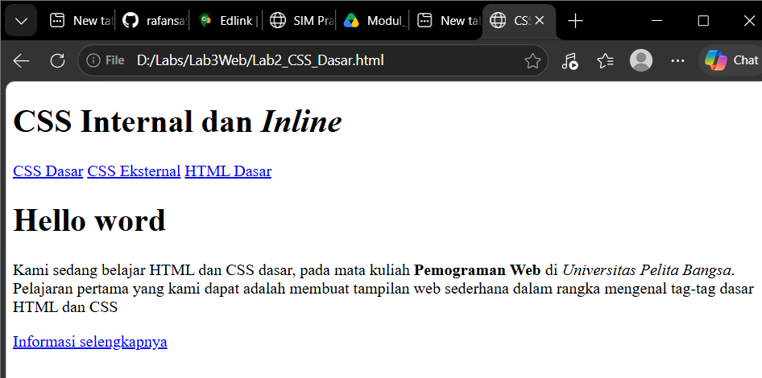
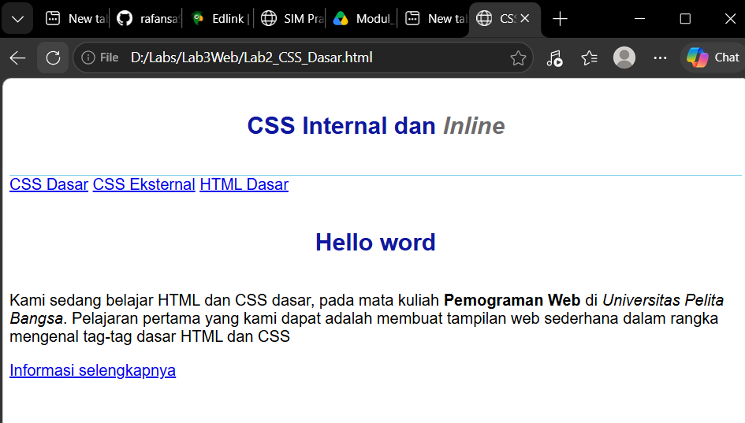
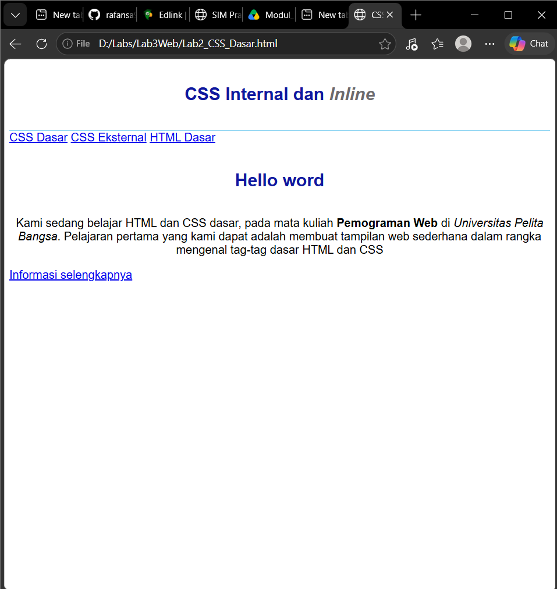
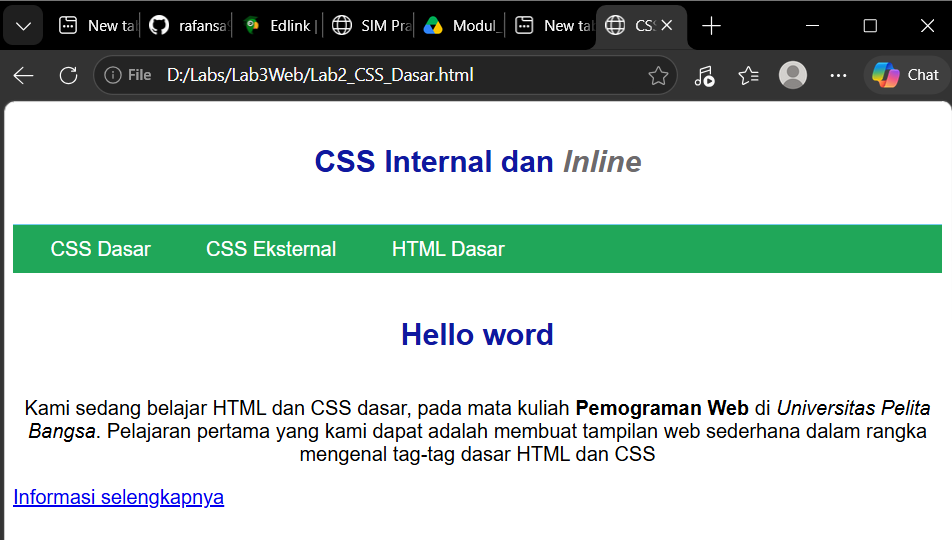
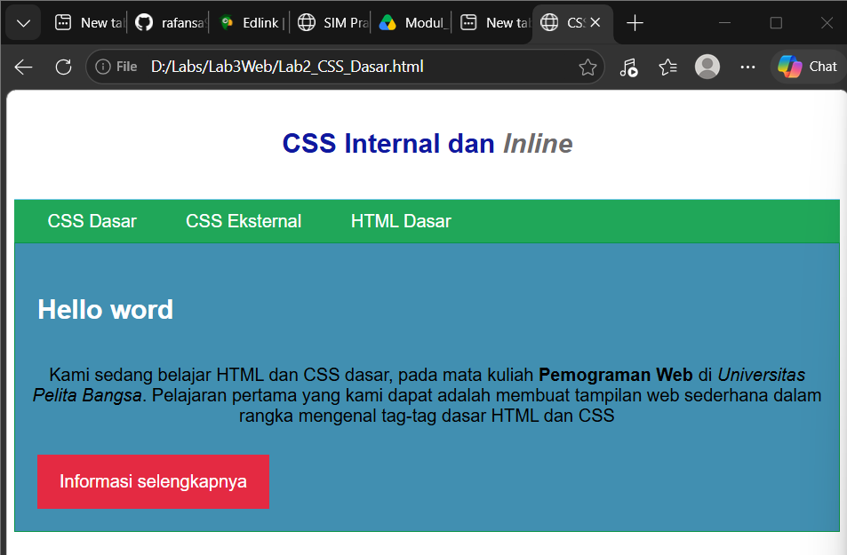

# Lab3Web
## PRAKTIKUM CSS Dasar
## MEMBUAT CSS Internal dan Inline CSS
Ini adalah Hasil dari Tampilan Web Saya
Rafli Ryan Saputra
312510023
# Menambahkan Foto





# LAPORAN PRAKTIKUM CSS

## 1. Eksperimen Properti dan Nilai CSS

Saya melakukan eksperimen dengan mengubah dan menambahkan beberapa properti CSS, seperti `color`, `background-color`, `font-size`, `text-align`, `padding`, dan `border`.

Contoh kode CSS:

```css
h1 {
    color: blue;
    text-align: center;
}

p {
    color: black;
    background-color: lightgray;
    font-size: 18px;
    padding: 10px;
    border: 1px solid black;
}
```

**Hasil eksperimen:**

Judul menjadi berwarna biru dan berada di tengah. Paragraf memiliki tulisan berwarna hitam, latar belakang abu-abu, ukuran huruf 18 piksel, jarak di dalam elemen, serta garis tepi berwarna hitam.

## 2. Perbedaan Selector `h1` dan `#intro h1`

Selector `h1` digunakan untuk mengatur semua elemen HTML `<h1>`. Sementara itu, selector `#intro h1` digunakan untuk mengatur elemen `<h1>` yang berada di dalam elemen dengan ID `intro`.

Contoh CSS:

```css
h1 {
    color: blue;
}

#intro h1 {
    color: red;
}
```

Contoh HTML:

```html
<h1>Judul Pertama</h1>

<div id="intro">
    <h1>Judul Kedua</h1>
</div>
```

**Penjelasan:**

Judul pertama berwarna biru, sedangkan judul kedua berwarna merah karena berada di dalam elemen dengan ID `intro`. Selector `#intro h1` memiliki spesifisitas lebih tinggi daripada selector `h1`.

## 3. Prioritas CSS Internal, Eksternal, dan Inline

CSS internal ditulis menggunakan tag `<style>` di dalam HTML, CSS eksternal ditulis dalam file terpisah, sedangkan inline CSS ditulis langsung pada atribut `style` suatu elemen HTML.

Contoh CSS eksternal (`style.css`):

```css
p {
    color: blue;
}
```

Contoh CSS internal:

```html
<style>
    p {
        color: red;
    }
</style>
```

Contoh inline CSS:

```html
<p style="color: green;">Belajar CSS</p>
```

**Penjelasan:**

Tulisan paragraf akan berwarna hijau karena inline CSS memiliki prioritas lebih tinggi daripada deklarasi internal dan eksternal biasa. Namun, prioritas juga dapat dipengaruhi oleh `!important`, spesifisitas selector, dan urutan deklarasi CSS.

## 4. Prioritas Selector ID dan Class

Selector ID menggunakan tanda pagar (`#`), sedangkan selector Class menggunakan tanda titik (`.`). Selector ID memiliki spesifisitas lebih tinggi daripada selector Class.

Contoh CSS:

```css
#paragraf-1 {
    color: red;
}

.text-paragraf {
    color: blue;
}
```

Contoh HTML:

```html
<p id="paragraf-1" class="text-paragraf">
    Ini adalah contoh paragraf.
</p>
```

**Penjelasan:**

Tulisan paragraf akan berwarna merah karena selector `#paragraf-1` memiliki spesifisitas lebih tinggi daripada selector `.text-paragraf`. Dengan demikian, ketika kedua selector mengatur properti yang sama dan tidak ada aturan dengan prioritas lebih tinggi, deklarasi ID yang diterapkan oleh browser.